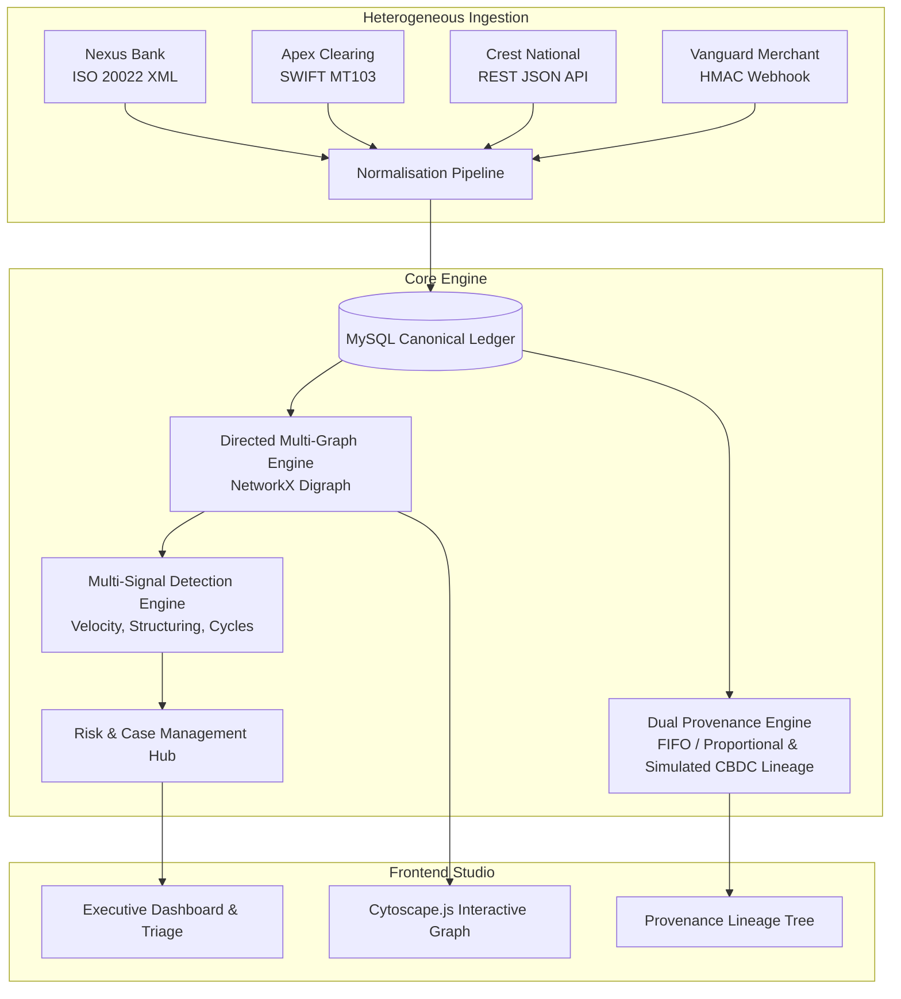

# MULE MATRIX — Follow the Money. Uncover the Network.

**Mule Matrix** is an end-to-end financial cybersecurity and fraud investigation platform purpose-built for detecting complex money mule networks, structured smurfing, peeling chains, circular round-tripping, and cross-institutional layering.

---

## 🏛 Platform Architecture



---

## 🚀 Key Modules & Capabilities

1. **Multi-Bank Ingestion & Normalisation Pipeline**:
   - **Nexus Bank**: ISO 20022 XML (`pacs.008.001.08`) financial messaging.
   - **Apex Clearing**: SWIFT MT103 FIN colon-tag records (`:20:`, `:32A:`, `:50K:`, `:59:`, `:71A:`).
   - **Crest National**: Nested JSON core banking transactions.
   - **Vanguard Merchant**: Unix timestamped, cent-scaled webhook events.

2. **Directed Multi-Graph Engine (`NetworkX`)**:
   - Forward and backward multi-hop traversal with temporal causality constraints ($t_{hop} \ge t_{prev}$).
   - Cycle detection algorithm for uncovering circular wash networks.
   - Centrality measures: In-Degree, Out-Degree, Fan-In/Fan-Out velocity ratios.

3. **Dual Provenance & Conservation Engine**:
   - **Simulated CBDC Token Lineage**: Parent-child token DAG with strict mathematical conservation ($\sum \text{Inflow} = \sum \text{Outflow} + \sum \text{Retained Fee}$).
   - **Conventional Attribution**: Value-lot FIFO and proportional distribution across non-tokenized bank ledgers.

4. **Attack Scenario Simulation Studio**:
   - **Rapid Fan-Out (Smurfing)**: Single high-value deposit split into multiple sub-threshold accounts within minutes.
   - **Peeling Chain (Decay Hop)**: Sequential multi-hop chain with fee commission retention.
   - **Circular Wash**: Multi-institutional directed cycle returning funds to initial ring.
   - **Cross-Bank Layering**: Complex topology traversing all 4 heterogeneous bank formats.
   - Automatic benchmark reporting with **Precision**, **Recall**, and **F1 Score** against programmatic ground truth.

5. **Modern Interactive UI**:
   - Dark theme using Charcoal / Earth Brown / Burnt Amber financial cybersecurity palette.
   - Cytoscape.js topology canvas with force-directed physics layout, neighborhood expansion, and node dossiers.
   - Lineage tree visualizer with cryptographic split badges and conservation invariants.

---

## 🛠 Running the Application

### 1. Backend (FastAPI + Python 3.10+)

```bash
cd backend

# Install dependencies
pip install -r requirements.txt

# Run pytest automated test suite (35 tests passing)
python -m pytest tests -v

# Start FastAPI development server
uvicorn main:app --reload --host 0.0.0.0 --port 8000
```

- API Docs: `http://localhost:8000/docs`
- Health check: `http://localhost:8000/api/v1/health`

### 2. Frontend (React + TypeScript + Vite)

```bash
cd frontend

# Install dependencies (already prepared)
npm install

# Run Vite dev server
npm run dev

# Or build for production
npm run build
```

- Web UI: `http://localhost:5173`

---

## 🧪 Verified Test Suite

```text
============================= 35 passed in 30.71s =============================
- TestBankAAdapter: 4/4 passed
- TestBankBAdapter: 2/2 passed
- TestBankCAdapter: 4/4 passed
- TestBankDAdapter: 3/3 passed
- TestProvenanceEngine: 7/7 passed
- TestGraphEngine: 6/6 passed
- TestScenario3Temporal: 3/3 passed
- TestScenario4BelowThreshold: 2/2 passed
- TestBehaviouralDetection: 4/4 passed
```
